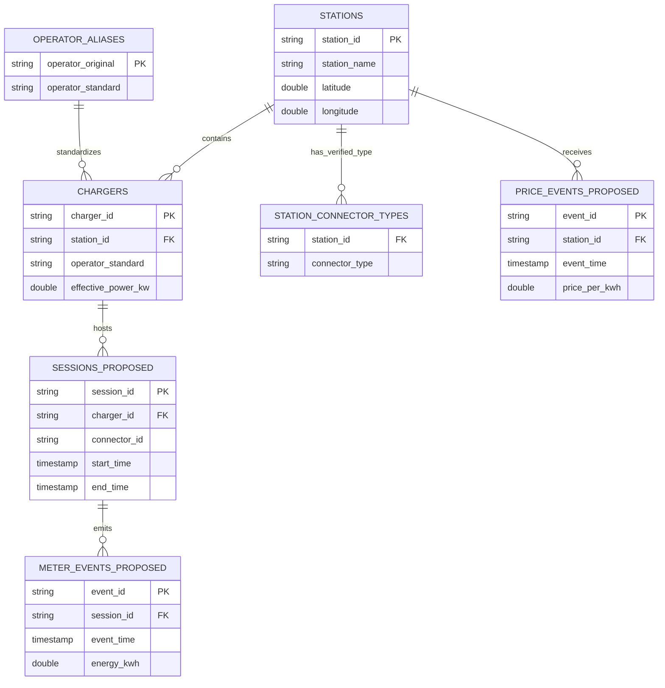

# Schema Diagram

The solid metadata relationships exist in the P0 DuckDB. Event entities are **PROPOSED** for Task 4 and are not implemented yet.

`connector_id` remains proposed because the A1 source identifies configuration rows and plug counts, not physical connector instances. It must be reconciled with the teacher generator before event tables are finalized.
